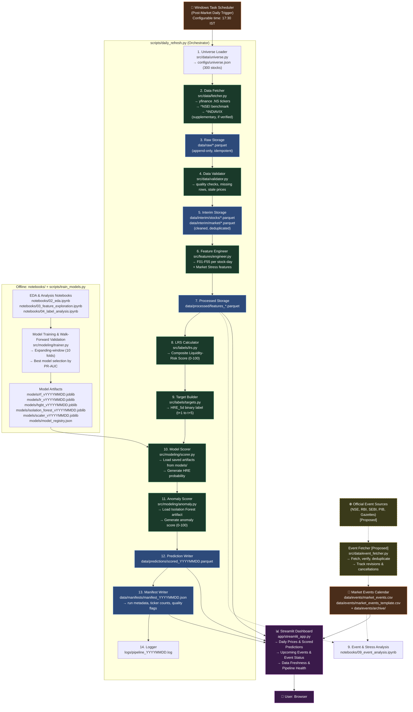

# ARCHITECTURE
## ML-Based Liquidity and Trading-Risk Intelligence for Indian Equities

**Version:** 1.2
**Status:** System Architecture — Phase 4.2 Complete (Active Implementation; Daily Event Fetching & Robust Refresh Proposed)

---

## 1. System Architecture Diagram



---

## 2. Folder Structure

```
liquidity-risk-intelligence/
│
├── README.md                          # Comprehensive project overview, setup, methodology
├── requirements.txt                   # Pinned Python dependencies
├── pyproject.toml                     # Project packaging and tool configuration
├── .gitignore                         # Configured repository ignore rules
│
├── audit/                             # Audit trail & data integrity verification
│   ├── compute_raw_sha256.py          # SHA-256 Merkle root verification utility
│   ├── raw_data_sha256.json           # Baseline hashes for all 303 raw Parquet files
│   └── smallcap250_adtv_ranked.csv    # Smallcap 250 ADTV ranking audit evidence
│
├── configs/                           # Version-controlled configuration files
│   ├── universe.json                  # 300 tickers (100 Large, 150 Mid, 50 Small), benchmark, VIX
│   ├── pipeline_config.yaml           # File paths, fetch params, retry logic, date ranges
│   ├── feature_config.yaml            # F01-F55 feature toggles, lookback windows, LRS weights
│   ├── model_config.yaml              # Hyperparameters, walk-forward splits, decision threshold
│   └── dashboard_config.yaml          # Streamlit UI settings, risk bands, color scheme
│
├── data/                              # Data directory (market data excluded from Git)
│   ├── raw/                           # Original downloads from yfinance (Parquet)
│   │   ├── stocks/<TICKER>.parquet    # 300 individual stock Parquet files
│   │   └── market/<INDEX>.parquet     # ^NSEI, ^NSEBANK, ^INDIAVIX benchmark files
│   ├── interim/                       # Cleaned, validated, deduplicated Parquets
│   │   ├── stocks/
│   │   │   └── ohlcv_clean.parquet    # Validated stock interim dataset (565,190 rows)
│   │   └── market/                    # Cleaned market indices
│   │       ├── nifty50_clean.parquet
│   │       ├── banknifty_clean.parquet
│   │       └── india_vix_clean.parquet
│   ├── processed/                     # Feature-engineered datasets
│   │   └── features_YYYYMMDD.parquet  # Full feature matrix with 55 features + is_warmup flag
│   ├── predictions/                   # Daily scored outputs
│   │   └── scored_YYYYMMDD.parquet    # LRS, HRE_prob, anomaly_score per stock
│   ├── manifests/                     # Run metadata, ticker counts, quality audit trail
│   │   └── manifest_YYYYMMDD.json     # Ticker counts, quality flags, runtime metrics
│   └── events/                        # Curated market-wide event calendar (committed)
│       ├── market_events.csv          # Canonical active market events calendar
│       ├── market_events_template.csv # Elections, geopolitics, circuit halts (reference template)
│       └── archive/                   # [PROPOSED/NOT IMPLEMENTED] Versioned revision history snapshots
│
├── docs/                              # Project architecture, guides, and specifications
│   ├── ARCHITECTURE.md                # Canonical architecture document
│   ├── SCALABILITY_GUIDE.md           # Software scalability & memory guide
│   ├── FEASIBILITY_AUDIT.md           # Feasibility benchmarks & constraints
│   ├── PROJECT_STATUS.md              # Current milestone progress & readiness audit
│   └── ...                            # Full specification set
│
├── notebooks/                         # Chronological exploratory Jupyter notebooks
│   ├── README.md                      # Notebook sequence index and input/output contracts
│   ├── 01_data_collection.ipynb       # Phase 1 & 3: pilot check, yfinance audit, VIX verification
│   ├── 02_eda.ipynb                   # Phase 6: exploratory data analysis, quality distributions
│   ├── 03_feature_exploration.ipynb   # Phase 6: feature distributions, correlation matrix, scaling
│   ├── 04_label_analysis.ipynb        # Phase 7: composite LRS calibration, HRE class balance
│   ├── 05_model_baseline.ipynb        # Phase 8: Logistic Regression baseline + walk-forward folds
│   ├── 06_model_rf.ipynb              # Phase 8: Random Forest + Gini/permutation importance
│   ├── 07_model_hgbt.ipynb            # Phase 8: HistGradientBoosting low-RAM experiments
│   ├── 08_anomaly_detection.ipynb     # Phase 8: Isolation Forest unsupervised historical anomaly
│   ├── 09_event_analysis.ipynb        # Phase 9: Market stress & major market events event study
│   └── 10_dashboard_prototype.ipynb   # Phase 11: Plotly chart mock-ups & component prototyping
│
├── src/                               # Production Python package (importable)
│   ├── __init__.py
│   ├── data/                          # Data acquisition, validation, storage
│   │   ├── __init__.py
│   │   ├── universe.py                # Universe loader (300 stocks across tiers)
│   │   ├── fetcher.py                 # yfinance download, retry, rate-limiting, VIX fetch
│   │   ├── validator.py               # Quality gates: zero volume, stale price, extreme gaps
│   │   ├── storage.py                 # Atomic Parquet IO, deduplication on (date, ticker)
│   │   ├── events.py                  # Event calendar manager and schema validator
│   │   └── event_fetcher.py           # [PROPOSED/NOT IMPLEMENTED] Official source event fetcher, deduplication & revision tracker
│   ├── features/                      # Feature engineering (F01-F55)
│   │   ├── __init__.py
│   │   ├── engineer.py                # Per-stock orchestration, float32 casting, warm-up tagging
│   │   ├── returns.py                 # F01-F10: Returns and price behaviour
│   │   ├── volatility.py              # F11-F22: Volatility and downside risk
│   │   ├── liquidity.py               # F23-F36: Liquidity and trading-activity proxies (Amihud)
│   │   ├── gaps.py                    # F37-F45: Price-gap and price-impact proxies (Corwin-Schultz)
│   │   ├── market_relative.py         # F46-F51: Market-relative features vs. ^NSEI
│   │   └── market_stress.py           # F52-F55: Market-stress features + supplementary VIX hooks
│   ├── labels/                        # Target and score design
│   │   ├── __init__.py
│   │   ├── lrs.py                     # Composite Liquidity-Risk Score (0-100) computation
│   │   └── targets.py                 # HRE_5d binary target construction (strictly future)
│   ├── modeling/                      # ML model training, scoring, anomaly detection
│   │   ├── __init__.py
│   │   ├── trainer.py                 # Expanding-window walk-forward training orchestrator
│   │   ├── scorer.py                  # Inference engine (loads artifacts, generates HRE_prob)
│   │   ├── anomaly.py                 # Isolation Forest training and 0-100 anomaly scoring
│   │   ├── evaluation.py              # ROC-AUC, PR-AUC, confusion matrix, segment evaluation
│   │   └── explainability.py          # Tree feature importance, permutation importance
│   ├── pipeline/                      # End-to-end pipeline orchestration
│   │   ├── __init__.py
│   │   ├── daily_pipeline.py          # Daily refresh orchestrator (post-market refresh)
│   │   └── health_check.py            # Data freshness (>2d warning), artifact verification
│   ├── reporting/                     # Report generation
│   │   ├── __init__.py
│   │   └── report_generator.py        # Generates markdown/HTML summary reports
│   └── utils/                         # Shared utilities
│       ├── __init__.py
│       ├── logger.py                  # Structured logging to console and logs/
│       ├── config.py                  # YAML/JSON config loaders
│       ├── dates.py                   # Trading calendar and date helpers
│       └── constants.py               # Global constants, risk bands, feature categories
│
├── app/                               # Streamlit dashboard
│   ├── streamlit_app.py               # Main navigation entry point
│   ├── pages/
│   │   ├── 1_Overview.py              # Market overview: top/bottom LRS, sector distributions, upcoming events banner
│   │   ├── 2_Stock_Detail.py          # Single-stock deep-dive: LRS history, features, anomaly markers
│   │   ├── 3_Portfolio_Risk.py        # Multi-stock portfolio risk aggregation
│   │   ├── 4_Anomaly_Log.py           # Historical anomaly browser (Isolation Forest)
│   │   └── 5_Data_Quality.py          # Pipeline health, manifest inspection, staleness alerts & run status
│   └── components/
│       ├── __init__.py
│       ├── charts.py                  # Reusable Plotly chart components
│       ├── tables.py                  # Formatted risk tables with risk-band coloring
│       └── filters.py                 # Date, ticker, segment filter controls
│
├── models/                            # Serialized model artifacts (git-ignored joblib files)
│   ├── .gitkeep
│   ├── model_registry.json            # Versioned registry mapping artifacts to metrics
│   ├── rf_vYYYYMMDD.joblib            # Random Forest artifact
│   ├── hgbt_vYYYYMMDD.joblib          # HistGradientBoosting artifact
│   ├── lr_vYYYYMMDD.joblib            # Logistic Regression baseline artifact
│   ├── isolation_forest_vYYYYMMDD.joblib # Isolation Forest artifact
│   └── scaler_vYYYYMMDD.joblib        # Fitted StandardScaler artifact
│
├── reports/                           # Project reports and presentation artifacts
│   ├── figures/                       # Evaluation charts for reports (.gitkeep tracked)
│   ├── final_report.md                # Main comprehensive project report
│   └── presentation.pptx              # Stakeholder slide deck
│
├── logs/                              # Runtime logs (git-ignored)
│   ├── .gitkeep
│   └── pipeline_YYYYMMDD.log          # Daily refresh execution logs
│
├── scripts/                           # Standalone execution scripts
│   ├── daily_refresh.bat              # Windows batch wrapper for Task Scheduler
│   ├── daily_refresh.py               # CLI runner for daily refresh pipeline
│   ├── train_models.py                # Full offline model training script
│   ├── build_universe.py              # One-time universe constituent parsing & filtering
│   └── backfill_history.py            # Historical bulk data backfill script
│
└── tests/                             # Unit and integration tests (pytest)
    ├── conftest.py                    # Shared synthetic data fixtures
    ├── test_fetcher.py                # Tests yfinance parameters, retry, empty response handling
    ├── test_validator.py              # Tests quality checks and data hygiene filters
    ├── test_features.py               # Tests feature formulas against analytical expectations
    ├── test_lrs.py                    # Tests LRS bounds [0, 100] and percentile weighting
    ├── test_targets.py                # Tests forward HRE_5d target construction & leakage protection
    ├── test_events.py                 # Tests event calendar schema, calendar alignment & timing
    └── test_event_fetcher.py          # [PROPOSED/NOT IMPLEMENTED] Tests event fetching, deduplication & revision lifecycle
```

---

## 3. Component Responsibilities

### src/data/fetcher.py
- Downloads OHLCV data from Yahoo Finance via yfinance.
- Fetches Nifty 50 benchmark (`^NSEI`).
- Audits and fetches candidate India VIX (`^INDIAVIX`) as supplementary fear index if verified in Phase 1.
- Supports two modes: full historical download and incremental (latest N days).
- Implements retry logic with exponential backoff for rate-limiting errors.
- Returns a standardized DataFrame; logs failed tickers to the manifest.
- Does NOT perform any feature engineering.
- **Daily Price Refresh & Schedule Handling:**
  - **Trading Calendar Awareness:** Integrates with the official NSE trading calendar (`data/interim/market/nifty50_clean.parquet`); skips execution on weekends and exchange holidays, recording a clean no-op in the manifest.
  - **Special Trading Sessions:** Recognizes special sessions (e.g., Diwali Muhurat trading, exchange disaster recovery mock trading sessions on Saturdays); adjusts expected trading windows and suppresses false-positive volume/liquidity drop flags.
  - **Delayed Data Settlement:** Accommodates post-market yfinance settlement latency for Indian equities (`.NS`), where end-of-day candles settle between 16:30 and 18:30 IST. Enforces a candle timestamp verification check to confirm date alignment before processing.
  - **Partial & Failed Download Handling:** Isolates ticker-level failures so transient timeouts or symbol suspensions do not halt the pipeline. Retries failed tickers with exponential backoff, records failed tickers in the manifest, and permits valid tickers to proceed to scoring.

### src/data/event_fetcher.py (Proposed / Not Yet Implemented)
- **Target Responsibility:** Automated fetching, verification, deduplication, and revision tracking of systemic market-wide events from official public sources.
- **Official Sources:** Connects to authoritative public regulatory and exchange feeds:
  - NSE Circulars & Press Releases (exchange halts, trading hour revisions, structural settlements).
  - RBI Monetary Policy Committee (MPC) Schedules & Press Statements (emergency repo rate revisions, liquidity facility changes).
  - SEBI Press Releases & Regulatory Orders (margin framework transitions, structural regulatory interventions).
  - Press Information Bureau (PIB) & Ministry of Finance (Union Budget dates, official fiscal statements).
  - Election Commission of India (ECI) (General Election schedules and counting dates).
  - *Strict Exclusions:* Excludes individual stock news, corporate earnings, analyst commentary, sentiment/NLP scraping, and excludes FII/FPI or DII data.
- **Verification & Deduplication:**
  - Validates announcements against authoritative links; assigns `verification_status` (`VERIFIED` vs. `PROVISIONAL`) and `date_confidence` (`HIGH`, `MEDIUM`, `LOW`).
  - Employs canonical event deduplication hashing: `hash(event_category, event_date, canonical_title)` to prevent duplicate entries from syndicated press notices.
- **Announcement Status & Revision Lifecycle:**
  - Tracks lifecycle states: `SCHEDULED`, `CONFIRMED`, `REVISED`, `POSTPONED`, or `CANCELLED`.
  - When an announcement date is rescheduled or postponed, preserves the original notice in audit metadata, updates status to `POSTPONED`/`REVISED`, and registers the updated effective trading date without creating phantom duplicates.
- **Revision History & Safe Updates:**
  - Archives previous state to `data/events/archive/market_events_YYYYMMDD_HHMMSS.csv` before writing changes.
  - Performs atomic write-and-replace on `data/events/market_events.csv` to ensure downstream consumers never read corrupted or partial event calendars.
- **Status:** Architectural design complete; marked as **proposed / not yet implemented** (manual curation via `src/data/events.py` is currently operational).

### data/events/ & Event Study Module
- Manages curated market-wide event calendar (`market_events.csv` and reference `market_events_template.csv`).
- Covers macroeconomic, geopolitical, electoral, and exchange-halt events using the 16-field validated schema.
- Explicitly excludes company-level news, earnings releases, NLP/sentiment, and FII/FPI/DII data.
- Supported by `src/data/events.py` (`EventCalendarManager`) for schema validation, trading date alignment against NIFTY 50 trading calendar, and look-ahead bias prevention.
- Utilized in `notebooks/09_event_analysis.ipynb` for stress-testing and liquidity shock analysis across the `[-5, +5]` trading day window.

### src/data/validator.py
- Applies quality filters: zero-volume rows, stale prices (same close for 3+ consecutive days), negative prices, extreme single-day moves (>50% gap, likely data error).
- Computes and logs coverage statistics per ticker.
- Flags (but does not automatically remove) suspicious rows — final removal decision logged.
- Outputs a quality report that is stored in the manifest.

### src/data/storage.py
- Handles all Parquet read/write operations.
- Implements idempotent upsert: if a stock-date row already exists, it is not duplicated.
- Deduplication key: (date, ticker).
- All writes are atomic: write to temp file, rename on success to prevent partial writes.

### src/features/engineer.py
- Orchestrates all feature modules (returns, volatility, liquidity, gaps, market_relative, market_stress).
- Processes one stock at a time to minimize peak RAM usage.
- Concatenates results and writes to data/processed/.
- Enforces warm-up window exclusion: rows within first 80 trading days of a stock's history are tagged `is_warmup=True` and excluded from model training.
- Evaluates optional supplementary India VIX features if verified.

### src/labels/lrs.py
- Computes the Composite Liquidity-Risk Score per stock per day.
- Percentile ranking is cross-sectional (across all stocks on each day) using the historical training distribution for rank calibration.
- **IMPORTANT:** In the daily refresh mode, percentile ranks are computed against the stored distribution from the full historical dataset — not recalibrated daily (which would require all historical data in memory).

### src/labels/targets.py
- Constructs the HRE_5d binary target.
- Requires future data (t+1 to t+5) — ONLY usable for training data, NOT for live scoring.
- Live scored rows will have `hre_5d = NaN` (outcome not yet known).

### src/modeling/trainer.py
- Implements expanding-window walk-forward validation.
- Fits scaler within each fold on training data only.
- Trains Logistic Regression, Random Forest, and HGBT.
- Evaluates each model and fold; selects the best model by validation PR-AUC.
- Saves final trained model (fit on full training data) as a versioned Joblib artifact.

### src/modeling/scorer.py
- Loads the latest model artifacts from models/.
- Applies the saved scaler and model to new feature rows.
- Outputs: `hre_prob` (float), `hre_flag` (0/1 at threshold 0.5), `model_version`.
- Does NOT retrain; inference only.

### app/streamlit_app.py
- Reads from `data/predictions/`, `data/processed/`, `data/events/`, and `data/manifests/`.
- Does NOT write to any data files (strictly read-only visualization).
- All heavy computation is done offline/post-market by the pipeline; dashboard only reads and renders.
- **Daily Prices & Predictions Display:**
  - Renders latest available trading session date, cross-sectional stock rankings, rule-based LRS (0-100), forward HRE 5-day risk probabilities (`hre_prob`), and Isolation Forest anomaly scores (0-100).
- **Upcoming Events & Event Status Display:**
  - Renders an Upcoming Systemic Events banner on the Overview and Stock Detail pages displaying scheduled events from `data/events/market_events.csv` within the next 10 trading days.
  - Displays event name, category (`MACRO_POLICY`, `REGULATORY_EXCHANGE`, etc.), scheduled date, market timing (`PRE_MARKET`, `DURING_MARKET`, `POST_MARKET`), verification status (`VERIFIED` / `PROVISIONAL`), and lifecycle state (`SCHEDULED`, `REVISED`, `POSTPONED`).
- **Data Freshness & Pipeline Health Display:**
  - Displays prominent freshness badges on the header and Data Quality page (`5_Data_Quality.py`): timestamp of latest market data ingested, elapsed time since last pipeline run, and staleness warnings if data >2 trading days old.
  - Inspects `data/manifests/manifest_YYYYMMDD.json` to display pipeline execution status (`SUCCESS`, `PARTIAL`, `FAILED`), universe coverage ratio (e.g., 298/300 active stocks scored), and list of any failed tickers.

---

## 4. Data Flow Summary

```
[Market Price & Trading Risk Flow]
yfinance API
    ↓ (fetcher.py: daily refresh with holiday/weekend/settlement checks & retries)
data/raw/*.parquet            [Raw OHLCV + ^NSEI benchmark + ^INDIAVIX (if verified)]
    ↓ (validator.py: hygiene checks & quality gates)
data/interim/stocks/*.parquet [Cleaned, validated, deduplicated stocks]
data/interim/market/*.parquet [Cleaned benchmark indices: Nifty 50, Bank Nifty, VIX]
    ↓ (engineer.py: F01-F55 features per stock-day)
data/processed/*.parquet      [Full 55-feature matrix + LRS + target]
    ↓ (scorer.py + anomaly.py: inference on saved model artifacts)
data/predictions/*.parquet    [HRE_prob + anomaly_score per stock-day]
    ↓
app/ (Streamlit)              [Daily prices, predictions, risk tiers]

[Market Event Intelligence Flow]
Official Sources (NSE, RBI, SEBI, PIB, Gazettes) [Proposed]
    ↓ (event_fetcher.py [Proposed / Not Yet Implemented]: verify, deduplicate, track revisions)
data/events/market_events.csv [Curated market events + archive/ revision history]
    ├──> notebooks/09_event_analysis.ipynb [Event Study: [-5, +5] stress analysis]
    └──> app/ (Streamlit) [Upcoming events banner, verification status & lifecycle]

[Execution Audit & Freshness Flow]
daily_refresh.py ──> data/manifests/manifest_YYYYMMDD.json ──> app/ (Streamlit) [Freshness badges & run status: SUCCESS / PARTIAL / FAILED]
```

---

## 5. Configuration Management

- All configurable parameters live in `configs/*.yaml` or `configs/*.json`.
- No hard-coded paths or parameters in source code.
- Environment-specific paths (absolute paths for Windows Task Scheduler) set in `configs/pipeline_config.yaml`.
- Secrets (API keys if added later) NEVER in config files; use environment variables.

---

## 6. Logging Strategy

- Python `logging` module; structured log files in `logs/`.
- Log levels: DEBUG (feature engineering details), INFO (pipeline step completions), WARNING (data quality flags), ERROR (failed tickers, unexpected exceptions).
- Each daily run creates a new log file named by date: `pipeline_YYYYMMDD.log`.
- Logs are NOT committed to Git.

---

## 7. Testing Strategy

- Unit tests for all `src/` modules using `pytest`.
- Feature tests verify against analytically computed expected values on small synthetic DataFrames.
- Storage tests verify idempotent append and deduplication.
- Tests use synthetic data only — no real market data committed to the test suite.
- Target coverage: >80% of src/ modules.

---

## 8. Git Practices

```gitignore
# Python virtual environments & bytecode
.venv/
venv/
__pycache__/
*.py[cod]

# Secrets & Environment variables
.env
*.pem
*.key

# Data & Models (Preserve configs, audit artifacts, and event templates)
data/raw/
data/interim/
data/processed/
data/predictions/
models/*.joblib
!data/events/*.csv
!data/manifests/*.json

# Runtime logs & temporary cache
logs/*.log
!logs/.gitkeep
*.tmp
*.tmp.parquet
.pytest_cache/
.ipynb_checkpoints/
```

- Notebooks SHOULD be committed.
- `configs/`, `audit/`, and `data/events/` ARE committed.
- `requirements.txt` and `pyproject.toml` ARE committed.
- `reports/figures/` visualizations ARE committed.
- `data/manifests/` CAN be committed (small JSON files; useful for audit trail).

---

## 9. Daily Refresh Execution, Scheduling & Failure Handling (Robustness Design)

> **Implementation Note:** Operational scripts currently execute offline training and baseline data loading. The end-to-end daily post-market refresh pipeline (`scripts/daily_refresh.py`, `src/pipeline/daily_pipeline.py`) and the automated event fetcher (`src/data/event_fetcher.py`) are **proposed architectural designs** scheduled for active integration in Phase 10. All capabilities documented below describe the target design and robust failure-handling protocols.

### 9.1 Daily Refresh Lifecycle & Execution Schedule
- **Trigger:** Configured via Windows Task Scheduler to run post-market at **17:30 IST** on trading days (`scripts/daily_refresh.bat` invoking `scripts/daily_refresh.py`).
- **Target Duration:** Execution across 300 stocks completes within ~8-12 minutes under sequential processing (rate-limit safe).
- **Sequential Pipeline Phases:**
  1. *Calendar & Freshness Gate:* Validates session eligibility against NSE calendar and confirms yfinance data settlement.
  2. *Market Data Acquisition:* Incremental download of latest session OHLCV for 300 universe tickers, `^NSEI`, and `^INDIAVIX`.
  3. *Validation & Quality Filtering:* Executes zero-volume, price-staleness, and extreme-gap checks.
  4. *Feature Engineering:* Computes F01-F55 features incrementally on latest window with `float32` memory protection.
  5. *Scoring & Anomaly Detection:* Generates rule-based LRS, forward HRE probabilities via saved ML models, and Isolation Forest anomaly scores.
  6. *Atomic Persistence & Manifest Generation:* Writes predictions and logs execution metadata.
  7. *Market Event Sync (Proposed):* Checks official sources for new or revised systemic event announcements.

### 9.2 Trading Calendar & Session Edge Cases
- **Weekends:** Pipeline evaluates the current date against the NSE calendar. Runs triggered on Saturday or Sunday (outside special sessions) immediately log a clean no-op status in the manifest and terminate without querying data APIs.
- **NSE Trading Holidays:** Checks official holiday schedule. On declared exchange holidays (e.g., Republic Day, Diwali Balipratipada), pipeline logs `HOLIDAY_SKIP` and cleanly exits.
- **Special Trading Sessions:**
  - *Diwali Muhurat Trading:* 1-hour evening trading session. Recognized as a valid single-day session; standard volume thresholds are dynamically scaled down to prevent false-positive liquidity drop warnings.
  - *Disaster Recovery / Mock Saturday Sessions:* Exchange sessions with truncated hours or abnormal volume profiles. Handled with explicit session tags in the manifest to prevent skewing 20-day moving averages.
- **Delayed Data Settlement:**
  - Yahoo Finance end-of-day data for Indian equities (`.NS`) can exhibit settlement delays ranging from 30 to 90 minutes post-market (16:30 to 18:30 IST).
  - Before writing to `data/raw/`, the fetcher verifies that the latest available timestamp matches today's trading date. If data has not yet settled, the pipeline delays execution by a configurable backoff window (e.g., 15 minutes, up to 3 retries).
- **Failed or Partial Downloads:**
  - Network timeouts, HTTP 429 rate limits, or suspended ticker anomalies are isolated per stock.
  - Each ticker undergoes up to 3 retry attempts with exponential backoff (initial delay 1.0s, backoff factor 2.0).
  - If a ticker remains unreachable, it is logged to the manifest under `failed_tickers` and the pipeline continues processing the remaining universe.

### 9.3 Failure Handling, Last-Known-Good (LKG) State & Resilience
- **Last-Known-Good (LKG) Preservation:**
  - The Streamlit dashboard and downstream reporting always read from the latest valid persisted files in `data/predictions/` and `data/processed/`.
  - In the event of an unrecoverable pipeline crash (e.g., power interruption, upstream API failure, missing model artifact), all existing historical and previous-day prediction files remain untouched.
  - The dashboard automatically detects pipeline failure from the manifest and displays an informative warning banner: *"Displaying Last-Known-Good data from [YYYY-MM-DD]. Latest refresh failed."*
- **Atomic File Operations:**
  - Every file write (raw Parquets, interim datasets, processed feature matrices, predictions, and manifests) writes to a temporary file (`.tmp.parquet` or `.tmp.json`) and performs an atomic rename upon successful completion.
  - Prevents partial, truncated, or unreadable files from ever being exposed to downstream consumers.
- **Safe Retries & Idempotence:**
  - All pipeline modules enforce idempotent upsert keyed on `(date, ticker)`.
  - If a run fails mid-way, the operator can safely re-trigger `scripts/daily_refresh.py`. Existing valid rows are recognized and deduplicated; no duplicate records are generated.

### 9.4 Run Status Classification & Audit Trail
Every pipeline execution logs an entry in `logs/pipeline_YYYYMMDD.log` and writes a machine-readable manifest to `data/manifests/manifest_YYYYMMDD.json` containing one of three explicit run statuses:

| Run Status | Criteria & Behavior | Action Taken |
|---|---|---|
| `SUCCESS` | ≥98% of universe (≥294/300 stocks) and benchmark `^NSEI` fetched, validated, engineered, and scored successfully. | Daily predictions published; manifest records full audit metrics and runtime statistics. |
| `PARTIAL` | Benchmark `^NSEI` succeeded, but 1–6 tickers failed due to temporary suspension, symbol change, or rate limits. | Scored predictions generated for all available valid tickers; failed tickers flagged in manifest; dashboard displays partial coverage badge. |
| `FAILED` | Critical failure: benchmark `^NSEI` unavailable, network failure, model artifact missing, or schema validation breakdown. | Pipeline halts immediately; no partial predictions published; Last-Known-Good data preserved; error stack logged and manifest marked `FAILED`. |

### 9.5 Market Event Updates & Revision Lifecycle (Proposed / Not Yet Implemented)
- **Official Source Verification:**
  - Ingestion restricted strictly to official public authorities: NSE, RBI, SEBI, PIB, and ECI.
  - Manual or automated staging verifies announcements against authoritative gazettes or circular URLs before approval.
  - Explicitly excludes company news, earnings announcements, sentiment scraping, and FII/FPI or DII flow data.
- **Deduplication:**
  - Events are deduplicated using a composite key: `(event_category, event_date, canonical_title)`.
  - Ingestion ignores redundant wire reports or cross-posted press releases for previously logged events.
- **Revision, Postponement & Cancellation Lifecycle:**
  - Announcements undergo explicit status transitions: `SCHEDULED` → `CONFIRMED`, `REVISED`, `POSTPONED`, or `CANCELLED`.
  - If an official policy meeting or election counting date is rescheduled, the existing record is updated with status `POSTPONED` or `REVISED`, noting the prior date in the audit history. An updated record is registered for the new effective trading date, preventing orphan records or duplicate counting in downstream event studies.
- **Audit Revision History & Safe Calendar Updates:**
  - Before applying any modification to `data/events/market_events.csv`, an automated snapshot is archived to `data/events/archive/market_events_YYYYMMDD_HHMMSS.csv`.
  - Updates are validated against the 16-field schema (`src/data/events.py`) and written atomically, ensuring unbroken auditability and zero risk of corruption to the active calendar.
