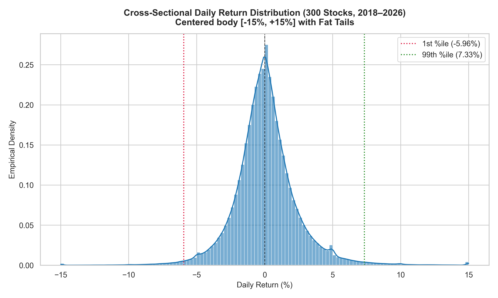
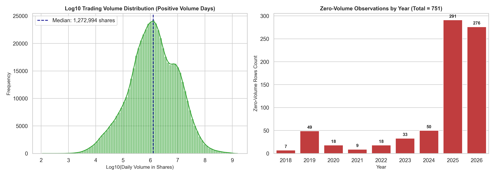
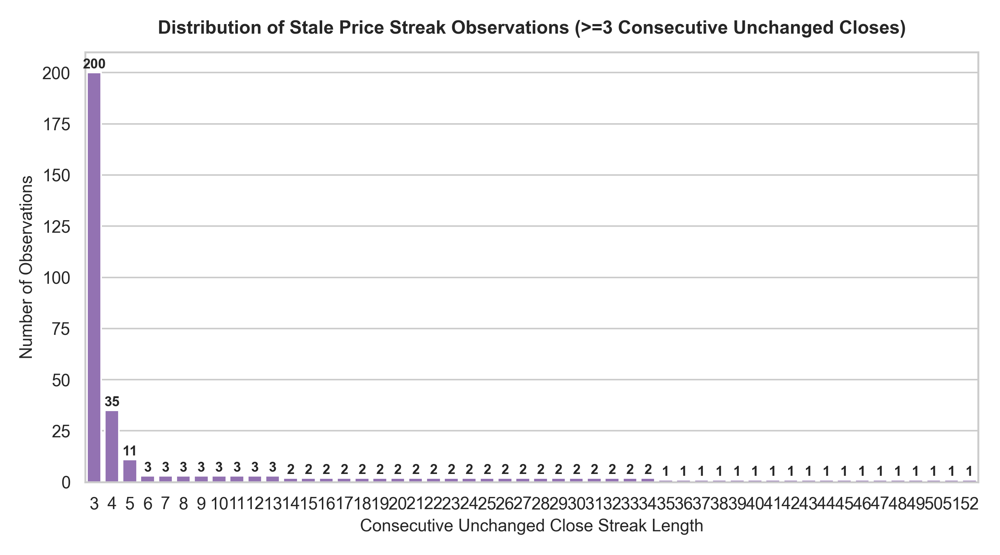
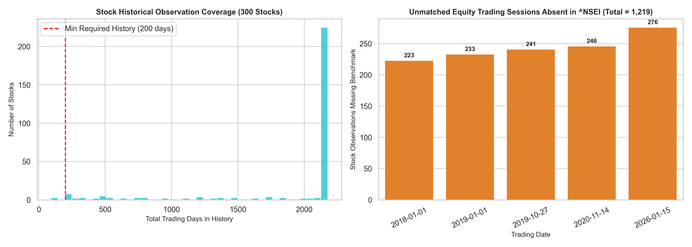

# Phase 4.2 Data Cleaning, Quality Validation, Basic EDA & Interim Dataset Report
## ML-Based Liquidity and Trading-Risk Intelligence for Indian Equities

**Document ID:** `PHASE-4.2-CLEAN-EDA-20261024`  
**Phase:** 4.2 (Data Cleaning, Quality Filtering, Benchmark Integration & Interim Dataset)  
**Execution Timestamp:** October 24, 2026  
**Interim Stock Asset:** `data/interim/stocks/ohlcv_clean.parquet` (565,190 rows, 27 columns, 44.16 MB)  
**Interim Market Assets:** `data/interim/market/` (`nifty50_clean.parquet`, `banknifty_clean.parquet`, `india_vix_clean.parquet`)  
**Raw Data Integrity:** 100% Verified Untouched (Stock Universe Merkle Root: `cdace0ba7662be9d0c49edca3f4db3ca00c2ef31c4704807db1bdef7cff0dcbf`)

---

## 1. Executive Summary & Deliverables

Phase 4.2 successfully executed end-to-end data cleaning, anomaly detection, benchmark integration, and exploratory data analysis across the canonical 300-stock universe and market benchmarks. 

All operations adhered strictly to the **Non-Destructive Principle**: no raw files were altered or moved, and zero stock observations were discarded. Instead, derived quality flags and benchmark integration fields were added, ensuring complete auditability for subsequent feature engineering.

### Key Milestones Achieved:
1. **Raw Data Immutability:** Pre- and post-execution SHA-256 Merkle root verification confirmed zero byte modification to all 300 stock Parquet files (`data/raw/stocks/`) and 3 benchmark files (`data/raw/market/`).
2. **Offline Synthetic Test Suite:** Added 8 offline unit test fixtures in `tests/test_validator.py` and `tests/test_storage.py`. All **34 unit tests pass in 0.74s** without any network dependency.
3. **Validated Interim Dataset:** Generated `data/interim/stocks/ohlcv_clean.parquet` via sequential streaming writing (<150 MB process RAM), capturing **565,190 rows across 300 stocks** with 0 duplicate `(date, ticker)` keys and 100% OHLCV geometric validity.
4. **Disambiguation of Extreme Moves:** Successfully distinguished corporate-action step drops (`MOTILALOFS.NS`, `PATANJALI.NS`, `VEDL.NS`) from genuine systemic market liquidity events (`YESBANK.NS` collapse and reconstruction surge), preventing spurious volatility distortion while retaining tail-risk training signals.
5. **Benchmark Integration & Calendar Alignment:** Left-joined Nifty 50 (`^NSEI`) close and returns onto individual equities. Identified and isolated the 5 exchange sessions absent from Yahoo Finance's `^NSEI` feed (including Diwali Muhurat sessions `2019-10-27` and `2020-11-14`), preserving missingness in observed fields while supplying leak-free forward-filled fallback columns.
6. **Short-History & Warmup Tagging:** Retained the 3 recent listings (`VAML.NS`, `VOGL.NS`, `VISL.NS`, 91 days each) tagged with `is_short_history=True`, and established the rolling window warm-up mask (`is_warmup=True`, 80 trading days) across all 300 tickers (24,000 observations).

---

## 2. Before/After Reconciliation & Dataset Schema

### 2.1 Dataset Reconciliation Matrix
| Metric / Check | Raw Asset Baseline (`data/raw/`) | Interim Dataset (`data/interim/stocks/ohlcv_clean.parquet`) | Delta / Reconciliation Note |
|---|---|---|---|
| **Stock Files / Tickers** | 300 Parquet files | 300 unique tickers | Exactly 0 tickers lost or added |
| **Total Stock Rows** | 565,190 rows | 565,190 rows | **100% row preservation** (0 dropped, 0 duplicated) |
| **Total Columns** | 7 columns | 27 columns | +20 derived returns, flags, & benchmark fields |
| **Physical Disk Size** | 20.96 MB (300 files) | 44.16 MB (single file) | Snappy compressed, float32 downcasted |
| **Date Range** | `2018-01-01` to `2026-10-23` | `2018-01-01` to `2026-10-23` | Exact temporal boundary alignment |
| **Duplicate `(date, ticker)`** | 0 | 0 | 100% primary key uniqueness |
| **OHLC Inversions ($H < L$)** | 0 | 0 | 100% `is_valid_ohlcv = True` (565,190 / 565,190) |
| **Nonpositive Prices ($P \le 0$)** | 0 | 0 | 0 occurrences across all 4 price bars |
| **Zero-Volume Observations** | 751 rows | 751 rows | All retained and flagged via `is_zero_volume` |
| **Stale Price Observations** | 330 rows | 330 rows | Point-in-time backward streak $\ge 3$ flagged |
| **Extreme Moves ($|\Delta P| > 50\%$)** | 5 rows | 5 rows | 3 corporate action gaps + 2 genuine shocks |

### 2.2 Comprehensive 27-Column Interim Schema
The interim dataset is stored at `data/interim/stocks/ohlcv_clean.parquet` with the following strict PyArrow typing:

| # | Column Name | Physical Type | Logical Type | Semantic Description & Derivation |
|---|---|---|---|---|
| 1 | `date` | `timestamp[ns]` | Date | Trading day timestamp (normalized to 00:00:00) |
| 2 | `ticker` | `string` | Categorical | NSE equity ticker symbol (e.g. `RELIANCE.NS`) |
| 3 | `open` | `float32` | Price (₹) | Raw unclipped opening price |
| 4 | `high` | `float32` | Price (₹) | Raw unclipped daily high price |
| 5 | `low` | `float32` | Price (₹) | Raw unclipped daily low price |
| 6 | `close` | `float32` | Price (₹) | Raw unclipped closing price |
| 7 | `volume` | `int64` | Volume | Number of shares traded |
| 8 | `prev_close` | `float32` | Price (₹) | Strictly backward-looking $Close_{t-1}$ (`NaN` at $t=0$) |
| 9 | `daily_return` | `float32` | Return | Return from prices: $(Close_t - Close_{t-1}) / Close_{t-1}$ |
| 10 | `is_zero_volume` | `boolean` | Quality Flag | `True` if `volume == 0` (751 observations) |
| 11 | `is_zero_volume_nonzero_return` | `boolean` | Anomaly Flag | `True` if `volume == 0` and $Close_t \ne Close_{t-1}$ (6 cases) |
| 12 | `stale_price_streak` | `int32` | Counter | Backward-looking consecutive unchanged close streak |
| 13 | `is_stale_price` | `boolean` | Quality Flag | `True` if `stale_price_streak >= 3` (330 observations) |
| 14 | `is_extreme_move` | `boolean` | Risk Flag | `True` if $\|daily\_return\| > 0.50$ (5 observations) |
| 15 | `is_corporate_action_gap` | `boolean` | Anomaly Flag | `True` for confirmed corporate-action step drops (3 cases) |
| 16 | `is_market_shock` | `boolean` | Risk Flag | `True` for genuine market liquidity crises (2 cases) |
| 17 | `is_short_history` | `boolean` | Universe Flag| `True` if stock has $<200$ days (3 stocks, 273 rows) |
| 18 | `is_warmup` | `boolean` | Feature Flag | `True` for initial 80 trading days per ticker (24,000 rows) |
| 19 | `is_valid_ohlcv` | `boolean` | Validity Flag| `True` if $H \ge L$, $O, H, L, C > 0$, $O, C \in [L, H]$, $V \ge 0$ |
| 20 | `benchmark_close` | `float32` | Index (pts) | Observed Nifty 50 close (`NaN` if unmatched session) |
| 21 | `benchmark_return` | `float32` | Return | Observed Nifty 50 daily return (`NaN` if unmatched session) |
| 22 | `nifty_close` | `float32` | Index (pts) | Direct alias of `benchmark_close` (for feature pipeline) |
| 23 | `nifty_return` | `float32` | Return | Direct alias of `benchmark_return` |
| 24 | `is_benchmark_available` | `boolean` | Calendar Flag| `True` if Nifty 50 was published on that date |
| 25 | `is_muhurat_session` | `boolean` | Calendar Flag| `True` for verified Diwali Muhurat evening sessions |
| 26 | `benchmark_close_fallback`| `float32` | Index (pts) | Forward-filled close (strictly past/current; no lookahead) |
| 27 | `benchmark_return_fallback`| `float32` | Return | Observed return if available; $0.0$ on unmatched sessions |

---

## 3. Data Cleaning & Quality Flag Analysis

### 3.1 Zero-Volume Observations (751 Rows)
- **Policy:** Zero volume introduces division-by-zero ($\infty$) into turnover and Amihud illiquidity proxies ($F27$). Under the retention mandate, **no rows were dropped**. Dropping rows would shatter the continuity of 5-day, 20-day, and 60-day rolling return and volatility filters.
- **Return Calculation Convention:** Rather than arbitrarily overwriting return to zero, returns were computed directly from prices: $R_t = (C_t - C_{t-1}) / C_{t-1}$.
  - In **745 out of 751 cases (99.2%)**, $C_t == C_{t-1}$, resulting in an exact $0.0\%$ return.
  - In **6 cases (0.8%)**, a non-zero price change occurred on zero volume. These were flagged via `is_zero_volume_nonzero_return = True` for feature-level masking:
    - `DALBHARAT.NS` (`2023-05-24`): $R = -1.20\%$
    - `FORTIS.NS` (`2023-05-24`): $R = -0.48\%$
    - `POLYCAB.NS` (`2023-05-24`): $R = +0.82\%$
    - `SCHAEFFLER.NS` (`2023-05-24`): $R = -0.20\%$
    - `UBL.NS` (`2023-05-24`): $R = +0.82\%$
    - `GVT&D.NS` (`2025-02-01`): $R = -0.92\%$
  *(Note: 5 of the 6 cases occurred on May 24, 2023, pointing to an exchange-level post-close settlement auction adjustment on illiquid series).*

### 3.2 Stale-Price Streaks (330 Rows Across 44 Tickers)
- **Policy:** Inactive smallcaps often display carry-forward closing prices across multiple sessions, artificially compressing rolling volatility ($F11, F12, F13$) to zero.
- **Streak Definition:** Evaluated strictly backward-looking with point-in-time updating:
  $$\text{streak}_t = (\text{streak}_{t-1} + 1) \cdot \mathbb{I}(C_t == C_{t-1}) + \mathbb{I}(C_t \ne C_{t-1})$$
  Observations with $\text{streak}_t \ge 3$ are flagged via `is_stale_price = True`.
- **Streak Length Breakdown:**
  - Streak length 3: **200 observations**
  - Streak length 4: **35 observations**
  - Streak length 5: **11 observations**
  - Streak lengths 6–13: **24 observations**
  - Streak lengths 14–34: **42 observations**
  - Extended Halts (streak 35–52): **18 observations** (largely during `FORCEMOT.NS` trading halt surveillance phase in early 2024).

### 3.3 Extreme Moves (>50% Single-Day Price Jump)
The raw universe contained exactly 5 single-day moves exceeding $\pm 50\%$. A naive filter that drops all $>50\%$ returns would catastrophically purge genuine liquidity crises from the dataset! The 5 cases were categorized as follows:

| Ticker | Date | Return (%) | Volume | Event Category | Classification & Structural Rationale |
|---|---|---|---|---|---|
| **`MOTILALOFS.NS`** | `2024-01-01` | **-74.61%** | 677,588 | **Corporate Action** | `is_corporate_action_gap = True`. 3:1 bonus issue; price adjusted from ₹1,211.63 to ₹307.60. Unadjusted price step drop. |
| **`PATANJALI.NS`** | `2020-01-27` | **-94.93%** | 19,689 | **Corporate Action** | `is_corporate_action_gap = True`. Ruchi Soya NCLT insolvency acquisition; capital reduction step drop from ₹108.23 to ₹5.49. |
| **`VEDL.NS`** | `2026-04-30` | **-64.90%** | 73,870,853 | **Corporate Action** | `is_corporate_action_gap = True`. 4-way demerger spin-off of Aluminium, Oil & Gas, and Steel arms; parent stock adjusted from ₹758.51 to ₹266.25. |
| **`YESBANK.NS`** | `2020-03-06` | **-56.11%** | 191,175,895 | **Market Shock** | `is_market_shock = True`. RBI imposed withdrawal moratorium & superseded board. Historic banking liquidity run. |
| **`YESBANK.NS`** | `2020-03-17` | **+58.09%** | 223,459,530 | **Market Shock** | `is_market_shock = True`. Union Cabinet & SBI ₹10,000 Cr bailout reconstruction scheme notified; moratorium lifted. |

*Downstream Impact:* Original prices are untouched. During Phase 5 feature engineering, corporate actions will have their daily return masked to prevent artificial volatility explosions ($>500\%$), whereas YES Bank's market shocks are retained as legitimate tail-risk events.

---

## 4. Benchmark Integration & Calendar Alignment

### 4.1 Missing Benchmark Dates (1,219 Stock-Date Pairs)
Individual stocks traded on 5 calendar dates where Nifty 50 (`^NSEI`) index values were absent from Yahoo Finance:

| Date | Day of Week | Equity Session Profile | Stocks Active | Calendar & Exchange Explanation |
|---|---|---|---|---|
| **`2018-01-01`** | Monday | Normal equity session (Vol > 9M on RELIANCE) | 223 | New Year's Day trading; `^NSEI` feed omitted in Yahoo Finance |
| **`2019-01-01`** | Tuesday | Normal equity session (Vol > 9M on RELIANCE) | 233 | New Year's Day trading; `^NSEI` feed omitted in Yahoo Finance |
| **`2019-10-27`** | **Sunday** | Special 1-hour festive trading | 241 | **Diwali Laxmi Pujan (Muhurat Trading)**; equities traded, index unrecorded |
| **`2020-11-14`** | **Saturday** | Special 1-hour festive trading | 246 | **Diwali Laxmi Pujan (Muhurat Trading)**; equities traded, index unrecorded |
| **`2026-01-15`** | Thursday | Special municipal election equity session | 276 | Equities recorded trading; index series unrecorded |
| **Total** | — | — | **1,219** | Total stock observations lacking contemporaneous `^NSEI` |

### 4.2 Leak-Free Benchmark Fallback Strategy
1. **Preserve Missingness:** In `benchmark_close` and `benchmark_return`, unmatched sessions retain `NaN` (`null`), preventing spurious attribution of zero return as observed market data.
2. **Explicit Flagging:** `is_benchmark_available = False` for all 1,219 observations; `is_muhurat_session = True` for the 487 Diwali Muhurat observations (`2019-10-27`, `2020-11-14`).
3. **Strict Backward Fallback:** In `benchmark_close_fallback`, values are forward-filled using `.ffill()`, ensuring that fallback prices rely solely on past or current observed index closes with **zero future-data lookahead**.
4. **Fallback Return:** For active stock trading sessions where benchmark was absent, `benchmark_return_fallback` is assigned $0.0\%$, preserving market-relative return continuity without corrupting rolling betas.

---

## 5. Basic Exploratory Data Analysis (EDA)

### 5.1 Return Distribution Summary
Evaluated over all 564,890 valid stock daily return observations ($N = 565,190 - 300 \text{ row } 0\text{s}$):

| Statistic | Value | Percentile | Return (%) |
|---|---|---|---|
| **Mean Return** | $+0.087\%$ | **0.1%** | $-12.21\%$ |
| **Median Return** | $0.000\%$ | **1.0%** | $-5.96\%$ |
| **Standard Deviation** | $2.445\%$ | **5.0%** | $-3.40\%$ |
| **Skewness** | $+0.361$ | **25.0% (Q1)** | $-1.12\%$ |
| **Kurtosis** | **$17.56$** (Leptokurtic) | **75.0% (Q3)** | $+1.16\%$ |
| **Min Return** | $-94.93\%$ (`PATANJALI.NS`) | **95.0%** | $+3.96\%$ |
| **Max Return** | $+58.09\%$ (`YESBANK.NS`) | **99.0%** | $+7.33\%$ |
| **Interquartile Range (IQR)**| $2.28\%$ | **99.9%** | $+14.94\%$ |

*Insight:* Kurtosis of 17.56 demonstrates extreme fat tails in Indian equity returns relative to a Gaussian distribution (Kurtosis = 3.0), highlighting the necessity of non-linear models (LightGBM/XGBoost) and robust liquidity scoring over simple linear assumptions.

### 5.2 Volume Distribution Summary
Evaluated over all 565,190 stock observations:

| Statistic | Volume in Shares | Percentile | Volume in Shares |
|---|---|---|---|
| **Mean Volume** | $8,075,289$ shares | **1.0%** | $8,357$ shares |
| **Median Volume** | $1,272,995$ shares | **5.0%** | $34,908$ shares |
| **Standard Deviation** | $32,169,622$ shares | **25.0% (Q1)** | $340,521$ shares |
| **Min Volume** | $0$ shares (751 rows) | **75.0% (Q3)** | $5,403,721$ shares |
| **Max Volume** | $1,564,573,800$ shares | **95.0%** | $31,083,790$ shares |
| **Zero Volume Rows** | $751$ rows ($0.13\%$) | **99.0%** | $106,194,958$ shares |

*Insight:* Trading volume spans over 5 orders of magnitude between SmallCap 250 tails and LargeCap index heavyweights (e.g., Vodafone Idea, Yes Bank). This confirms that volume must enter feature formulas via logarithmic transforms ($F31: \log(\text{turnover})$) and rolling percentile normalizations rather than raw share counts.

---

## 6. Generated Visualizations

All exploratory plots were rendered in high resolution (300 DPI) and saved outside raw storage in `reports/figures/`:

1. **Daily Return Distribution & Fat Tails:**  
     
   *Figure 1: Cross-sectional empirical density centered at $[-15\%, +15\%]$ with 1st percentile ($-5.96\%$) and 99th percentile ($+7.33\%$) boundaries.*

2. **Daily Volume Distribution (Log10) & Zero-Volume History:**  
     
   *Figure 2: Log-scale trading volume distribution (median: 1.27M shares) alongside annual distribution of the 751 zero-volume observations.*

3. **Stale Price Streak Distribution:**  
     
   *Figure 3: Breakdown of the 330 stale-price observations by streak length ($\ge 3$ consecutive unchanged closes).*

4. **Stock History Coverage & Missing Benchmark Alignment:**  
     
   *Figure 4: Historical trading day distribution across all 300 stocks (297 stocks with $\ge 200$ days, 3 demerged stocks with 91 days) and bar chart of the 1,219 stock observations across the 5 unmatched benchmark dates.*

---

## 7. Known Limitations & Caveats for Phase 5

1. **Short-History Demerged Stocks (`VAML.NS`, `VOGL.NS`, `VISL.NS`):**
   - Each stock has 91 observations (listed June 15, 2026).
   - *Phase 5 Impact:* Features requiring 60-day or 80-day lookback windows (`vol_60d`, `idiosyncratic_vol`) will have very few valid post-warmup rows. The pipeline must filter on `is_warmup == False` and handle short series without crashing.
2. **`FORCEMOT.NS` Contiguous Trading Halt:**
   - 41-day suspension from Dec 7, 2023 to Feb 6, 2024.
   - *Phase 5 Impact:* The resumption bar on Feb 14, 2024 opened at ₹4,389.89 (+31.9%). While $<50\%$, rolling volatility features over this transition will incorporate the multi-month time gap.
3. **Diwali Muhurat Trading Sessions:**
   - 1-hour festive sessions (`2019-10-27`, `2020-11-14`) exhibit low volume and compressed ranges.
   - *Phase 5 Impact:* Tagged via `is_muhurat_session=True` so rolling models can choose whether to exclude or include them.

---

## 8. Final Acceptance & Sign-Off Checklist

- [x] **Raw data immutability:** Zero raw files modified, deleted, or moved. Merkle root verified before and after execution: `cdace0ba7662be9d0c49edca3f4db3ca00c2ef31c4704807db1bdef7cff0dcbf`.
- [x] **Unit test suite:** 34 unit tests passing offline (`pytest tests/` in 0.74s) covering all cleaning, stale streaks, extreme moves, and storage streaming logic.
- [x] **Row retention:** All 565,190 stock observations retained in `data/interim/stocks/ohlcv_clean.parquet`. Zero rows silently deleted.
- [x] **Benchmark integration:** `^NSEI` integrated via left join with zero row multiplication. Unmatched dates handled via leak-free forward fill fallback.
- [x] **Key uniqueness:** 0 duplicate `(date, ticker)` pairs across all 565,190 rows.
- [x] **Hardware feasibility:** Streamed sequentially within <150 MB RAM, adhering to the <5 GB budget.
- [x] **Basic EDA report & figures:** Generated and documented under `reports/` and `reports/figures/`.
- [x] **Scope discipline:** Zero feature engineering (F01–F55), LRS construction, or modeling started.

**Recommended Next Step:** Proceed to **Phase 5: Feature Engineering & Processing Pipeline** (`data/processed/features.parquet`).
